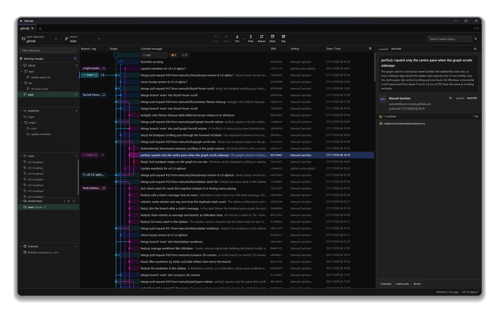
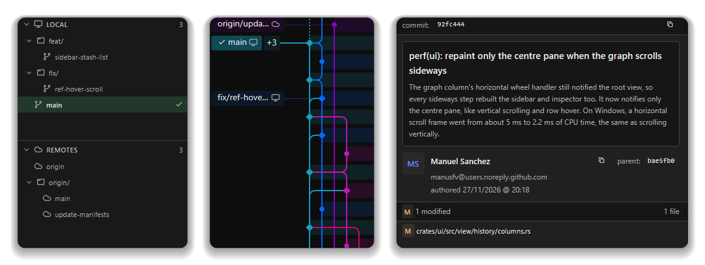
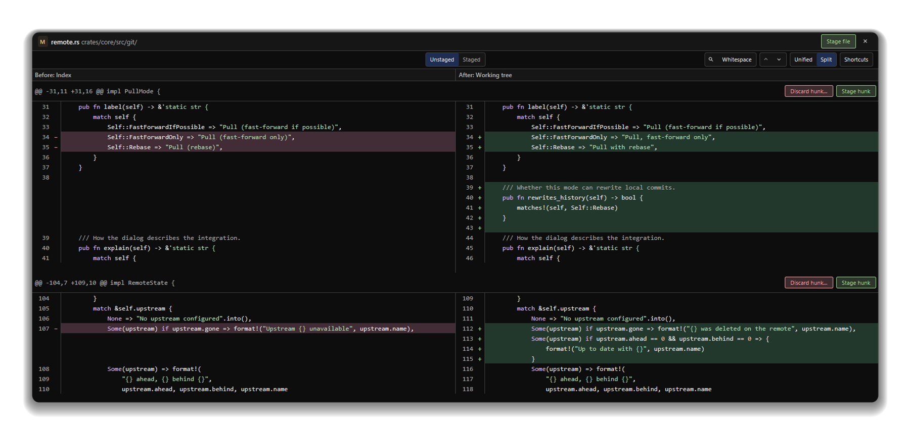

<h1 align="center">
  <picture>
    <source media="(prefers-color-scheme: dark)" srcset="icons/gitcrab-lockup-dark.svg">
    
  </picture>
</h1>

<p align="center">
  <strong>A fast, native Git client for exploring history, reviewing diffs and staging exactly what you mean to commit.</strong>
</p>

<p align="center">
  <a href="https://github.com/manusfv/gitcrab/releases"></a>
  
  
  <a href="LICENSE"></a>
</p>

<p align="center">
  <a href="#install"><b>Install</b></a> ·
  <a href="#features"><b>Features</b></a> ·
  <a href="#build-from-source"><b>Build from source</b></a> ·
  <a href="#contributing"><b>Contributing</b></a>
</p>

<p align="center">
  
</p>

GitCrab is a desktop Git client written in Rust and drawn on the GPU with [GPUI](https://github.com/zed-industries/zed/tree/main/crates/gpui). It runs your installed Git, so your config, hooks, credential helper and SSH agent work as they do in the terminal. It starts fast, stays responsive on large histories, and checks every write against the repository before running it.

> [!NOTE]
> GitCrab is in **alpha**. Releases are prereleases, and the app updates itself in place when a new one is out.

## Features

- **History you can read.** Each branch gets its own coloured lane in the graph, and branch and tag labels link to their commits. Older commits load as you scroll. Search the loaded history, and keep several repositories open in tabs.
- **Every ref in one sidebar.** Local branches grouped by folder, remotes, tags, worktrees and stashes. Right-click any of them for its actions: create, lock or remove a worktree, apply, pop, rename or drop a stash.
- **Unified or side-by-side diffs.** Jump between hunks, show whitespace, find text inside the diff, and copy lines or a patch.
- **Stage by file, hunk or line.** Select the rows you want and stage, unstage or discard only those, then write a summary and description and commit.
- **One-click operations.** Checkout, branch, merge, cherry-pick, revert, stash, fetch, pull (fast-forward, merge or rebase) and push. GitCrab never force-pushes, and Undo reverses commits, checkouts, new branches, stashes, merges, cherry-picks and reverts.
- **Recover from a stop.** Continue, skip or abort a merge, rebase, cherry-pick or revert that stopped on a conflict.
- **Start anywhere.** Open, clone or create a repository from the start screen, and reopen recent ones.

<p align="center">
  
  <br>
  <sub>Branches grouped by folder · lanes with linked labels · full commit details</sub>
</p>

<p align="center">
  
  <br>
  <sub>Split diff of working changes, with Stage hunk and Discard hunk on every hunk</sub>
</p>

## Install

Download the file for your system from the [latest release](https://github.com/manusfv/gitcrab/releases). Every platform also needs [Git 2.43 or newer](https://git-scm.com/downloads) on `PATH`.

| System | Installer (recommended) | Standalone |
| --- | --- | --- |
| **Windows** 10/11, x64 | `gitcrab-windows-x86_64-setup.exe` | `gitcrab-windows-x86_64.zip` |
| **macOS**, Apple Silicon | `gitcrab-macos-arm64.dmg` | — |
| **macOS**, Intel | `gitcrab-macos-x86_64.dmg` | — |
| **Linux**, x64 | `gitcrab-linux-x86_64.AppImage` | `gitcrab-linux-x86_64.tar.gz` |

Not sure which Mac you have? Apple menu → **About This Mac**: "Apple M…" is Apple Silicon. Windows and Linux on ARM are not built yet.

<details>
<summary><b>Windows</b></summary>

Run the setup `.exe`. It installs for the current user without an administrator prompt and adds a Start menu entry. The installer is not code-signed yet, so SmartScreen may warn: choose **More info → Run anyway**.

The `.zip` holds a standalone `gitcrab.exe` that runs from any folder.

</details>

<details>
<summary><b>macOS</b></summary>

Open the `.dmg` and drag **GitCrab** onto **Applications** (or any other folder; the app is self-contained).

Each release's notes say whether its macOS builds are signed and notarized. Until they are, macOS blocks the first launch with "GitCrab can't be opened" or "Apple could not verify…". Open it once with **System Settings → Privacy & Security → Open Anyway** (on macOS 14 and older you can also Control-click the app and choose **Open**), or remove the download quarantine after [checking the download](#verify-a-download):

```sh
xattr -dr com.apple.quarantine /Applications/GitCrab.app
```

</details>

<details>
<summary><b>Linux</b></summary>

```sh
chmod +x gitcrab-linux-x86_64.AppImage
./gitcrab-linux-x86_64.AppImage
```

GitCrab needs a working Vulkan driver. The `.tar.gz` holds a standalone `gitcrab` binary built on Ubuntu 24.04: it needs glibc 2.39 or newer and the system's X11/Wayland, xkbcommon, fontconfig, freetype and Vulkan libraries. If it doesn't start, `ldd gitcrab | grep "not found"` lists what is missing.

</details>

<details>
<summary><b>Verify a download</b></summary>

Each release has a `SHA256SUMS` file, and GitHub shows each file's SHA-256 on the release page.

```sh
sha256sum -c SHA256SUMS --ignore-missing          # Linux
shasum -a 256 -c SHA256SUMS --ignore-missing      # macOS
```

On Windows, compare `Get-FileHash <file>` with the matching line.

</details>

### First launch

Open, clone or create a repository from the start screen. Before GitCrab reads a repository it asks you to trust it, because trusted Git configuration can run programs such as hooks, filters and signing tools. It remembers your answer, asks again if the repository's resolved paths change, and can trust every repository in a parent folder at once.

GitCrab uses the Git on `PATH`. To use a specific installation, set `GITCRAB_GIT` to its absolute path. Inherited `GIT_*` environment variables are ignored; the normal system, user and repository config apply.

<details>
<summary><b>Keyboard shortcuts</b></summary>

On macOS, use <kbd>Cmd</kbd> where the table says <kbd>Ctrl</kbd> and <kbd>Option</kbd> for <kbd>Alt</kbd>.

| Action | Shortcut |
| --- | --- |
| Open a repository | <kbd>Ctrl</kbd>+<kbd>O</kbd> |
| New tab / close tab | <kbd>Ctrl</kbd>+<kbd>T</kbd> / <kbd>Ctrl</kbd>+<kbd>W</kbd> |
| Next / previous tab | <kbd>Ctrl</kbd>+<kbd>Tab</kbd> / <kbd>Ctrl</kbd>+<kbd>Shift</kbd>+<kbd>Tab</kbd> |
| Find in the open diff, or in history | <kbd>Ctrl</kbd>+<kbd>F</kbd> |
| Search loaded history | <kbd>Ctrl</kbd>+<kbd>Shift</kbd>+<kbd>F</kbd> |
| Next / previous match | <kbd>F3</kbd> / <kbd>Shift</kbd>+<kbd>F3</kbd> |
| Previous / next row | <kbd>↑</kbd> / <kbd>↓</kbd> |
| Previous / next hunk | <kbd>Alt</kbd>+<kbd>↑</kbd> / <kbd>Alt</kbd>+<kbd>↓</kbd> |
| Stage or unstage the selected file | <kbd>Alt</kbd>+<kbd>S</kbd> |
| Commit staged changes | <kbd>Ctrl</kbd>+<kbd>Enter</kbd> |
| Undo / redo the last operation | <kbd>Ctrl</kbd>+<kbd>Z</kbd> / <kbd>Ctrl</kbd>+<kbd>Shift</kbd>+<kbd>Z</kbd> |
| Copy lines / copy as patch | <kbd>Ctrl</kbd>+<kbd>C</kbd> / <kbd>Ctrl</kbd>+<kbd>Shift</kbd>+<kbd>C</kbd> |
| Refresh | <kbd>F5</kbd> |

</details>

## Build from source

You need [Rust 1.99.1](https://www.rust-lang.org/tools/install) (`rust-toolchain.toml` selects it), [Git 2.43 or newer](https://git-scm.com/downloads), and your platform's native build tools:

- **Windows:** the Rust MSVC toolchain, Visual Studio C++ build tools and the Windows SDK. Release builds use the SDK's shader compiler; if it isn't found, set `GPUI_FXC_PATH` to the path of `fxc.exe`.
- **macOS:** full Xcode, for the Metal tools. Build separately for each architecture.
- **Linux:** a desktop session with a working Vulkan driver, and these packages (Ubuntu 24.04):

  ```sh
  sudo apt-get install build-essential pkg-config clang libclang-dev libasound2-dev \
    libudev-dev libfontconfig1-dev libfreetype-dev libxkbcommon-dev \
    libxkbcommon-x11-dev libwayland-dev libxcb1-dev libxcb-xkb-dev libx11-xcb-dev \
    libvulkan-dev mesa-vulkan-drivers
  ```

Then clone and run:

```sh
git clone https://github.com/manusfv/gitcrab.git
cd gitcrab
cargo run --locked --release
```

Append `-- "/path/to/repository"` to open a repository directly. The binary is `target/release/gitcrab` (`gitcrab.exe` on Windows), and it identifies itself as a `local build`.

## Contributing

Bug reports, ideas and focused pull requests are welcome. When [reporting a bug](https://github.com/manusfv/gitcrab/issues/new), include your OS, the GitCrab version (bottom-right of the window) and the steps to reproduce it.

The code is a Cargo workspace whose crates keep the Git, graph and diff logic testable without a window:

| Crate | Role |
| --- | --- |
| [`core`](crates/core) | Repository models, graph and diff logic, the controller. No UI and no I/O. |
| [`git`](crates/git) | The Git worker: runs Git and answers core's requests. |
| [`settings`](crates/settings) | Preferences, session and repository trust files. |
| [`update`](crates/update) | Checks, verifies and installs updates. |
| [`ui`](crates/ui) | GPUI views and components. |
| [`app`](crates/app) | The `gitcrab` binary that wires them together. |

The [architecture notes](docs/architecture.md) explain which module owns each piece of state and its effects.

Before opening a pull request, run:

```sh
cargo fmt --all -- --check
scripts/check-boundaries.sh                      # crate boundaries + core tests
cargo test --locked --workspace --all-features
```

CI runs the same checks and a release build on Windows, Linux, Apple Silicon and Intel macOS. The Git worker's tests create throwaway repositories with the Git on `PATH`; set `GITCRAB_TEST_GIT` to an absolute path to test another installation.

Maintainers: see [Releasing](docs/releasing.md) and [Updates](docs/updates.md).

## License

GitCrab is [MIT licensed](LICENSE). Third-party material is listed in [THIRD_PARTY.md](THIRD_PARTY.md).
