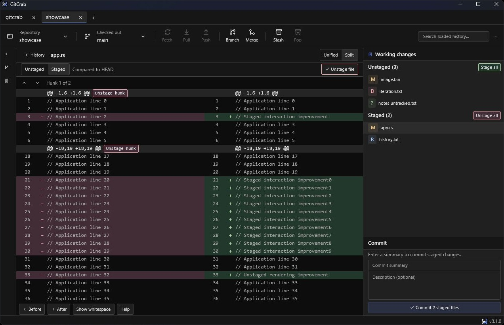

<h1 align="center">
  <picture>
    <source media="(prefers-color-scheme: dark)" srcset="icons/gitcrab-lockup-dark.svg">
    
  </picture>
</h1>

<p align="center"><strong>A native Git desktop client for exploring history, reviewing diffs, and staging hunks.</strong></p>

<p align="center">
  <a href="#install">Install</a> ·
  <a href="#what-you-can-do">What you can do</a> ·
  <a href="#contributing">Contributing</a>
</p>


## Install

Prebuilt executables will be published on [GitHub Releases](https://github.com/manusfv/gitcrab/releases). Until then, you can [build GitCrab from source](#build-from-source).

1. Install [Git 2.43 or newer](https://git-scm.com/downloads) so GitCrab can work with your repositories.
2. When release builds are available, download the asset that matches your operating system and processor architecture.
3. Launch GitCrab, choose a local repository, and confirm that you trust its Git configuration and metadata. GitCrab remembers your approval across restarts and asks again if the resolved repository paths change. It offers to reopen the last repository on your next launch.

## What you can do

- **Explore history.** Follow branches and tags through the commit graph, search loaded commits, and open a commit to inspect its metadata and changed files. Open multiple repositories in tabs and drag to reorder tabs or history columns.
- **Review changes.** Switch between unified and side-by-side diffs, jump between hunks, and show whitespace when it matters. Checkout, merge, cherry-pick, revert, stash, pull and push run in one click, each checked against the repository first; everything but push can be reversed with Undo.
- **Prepare a commit.** Open **Working changes**, select a file, and use **Stage hunk** on the change you want to include, or select rows and stage, unstage or discard just those lines. Review the staged diff, write a summary and optional description, then commit.
- **Stage or unstage the whole worktree.** The bulk controls act on changes Git finds when the command runs, including files that arrived after the last refresh. A single-file action rechecks the displayed status and rename before updating the index.

GitCrab opens trusted local repositories. Trusted Git configuration can start
programs such as hooks, filters, and signing tools. Use a trusted Git installation
on PATH, or set `GITCRAB_GIT` to an absolute executable path. The runner ignores
inherited `GIT_*` variables and reads normal system, user, and repository config.
Commit drafts stay in memory in their tab. Closing a tab or quitting with
drafts asks before discarding them.

### Split diff



### Keyboard shortcuts

| Action | Windows / Linux | macOS |
| --- | --- | --- |
| Open a repository | `Ctrl+O` | `Cmd+O` |
| Open a new repository tab | `Ctrl+T` | `Cmd+T` |
| Find in loaded history | `Ctrl+F` | `Cmd+F` |
| Select the previous or next history row | `↑` / `↓` | `↑` / `↓` |
| Refresh the repository | `F5` | `F5` |
| Commit staged changes | `Ctrl+Enter` | `Cmd+Enter` |
| Stage or unstage the selected working file | `Alt+S` | `Option+S` |
| Select all or copy diff lines | `Ctrl+A` / `Ctrl+C` | `Cmd+A` / `Cmd+C` |

## Project status

GitCrab is under active development. It fetches, pulls (fast-forward, merge or rebase) and pushes through your installed Git, using your credential helper and SSH agent; it never force-pushes. Remote management, clone, and an integrated conflict editor are future work. Staging supports whole files and hunks.

<details>
<summary>Current technical limits</summary>

- Side-by-side diffs align changes by position. Patches over 8 MiB, 50,000 lines, or 8,192 bytes on a line are handled with whole-file actions.
- Hunk discard is limited to supported UTF-8 worktree changes with LF line endings.
- Write commands, their hooks, and signing tools run to completion. Reads have deadlines and cancellation.
- Screen readers, IME and dead-key input, Wayland interaction, and multi-monitor DPI transitions need further validation.

</details>

## Contributing

GitCrab is written in Rust with a native [GPUI](https://github.com/zed-industries/zed/tree/main/crates/gpui) interface. The Git, graph, and diff code can be tested independently of the desktop renderer.

Bug reports and focused pull requests are welcome. Include your OS, the GitCrab revision, and steps to reproduce when reporting a bug. [Open an issue](https://github.com/manusfv/gitcrab/issues/new)

### Build from source

Use [Rust 1.99.1](https://www.rust-lang.org/tools/install), [Git 2.43 or newer](https://git-scm.com/downloads), and the native build tools for your platform.

<details>
<summary>Platform prerequisites</summary>

#### Windows x64

Use the Rust MSVC toolchain, Visual Studio C++ build tools, and the Windows SDK. Release builds require the SDK shader compiler. If discovery fails, set `GPUI_FXC_PATH` to the path of `fxc.exe`.

#### Linux x64

Use a desktop session with a working Vulkan driver. On Ubuntu 24.04, install the native dependencies with the following command.

```sh
sudo apt-get install build-essential pkg-config clang libclang-dev libasound2-dev \
  libudev-dev libfontconfig1-dev libfreetype-dev libxkbcommon-dev \
  libxkbcommon-x11-dev libwayland-dev libxcb1-dev libxcb-xkb-dev libx11-xcb-dev \
  libvulkan-dev mesa-vulkan-drivers
```

#### macOS · Apple Silicon and Intel

Install full Xcode for the Metal build tools. Build separately for each architecture.

</details>

```sh
git clone https://github.com/manusfv/gitcrab.git
cd gitcrab
cargo run --locked --release
```

To open a specific local repository, append `-- "/path/to/repository"` to the `cargo run` command.

### Development commands

```sh
cargo fmt --all -- --check
cargo test --locked -p gitcrab-core
cargo test --locked --workspace --all-features
cargo build --locked --release --bin gitcrab
```

The clean-checkout CI matrix pins Rust 1.99.1 and runs these checks on Windows
MSVC, Linux x64, Apple Silicon, and Intel macOS. Git worker tests (`gitcrab-git`) create
isolated repositories using the Git on PATH. Set `GITCRAB_TEST_GIT` to an absolute
executable path to test a specific Git installation.

The [architecture notes](docs/architecture.md) describe which module owns
each part of the state and its effects, and
native qualification covers the renderer
smoke test. The behavior decisions define repository trust,
confirmation lifetime, bulk staging scope, and draft recovery.

CI injects the verified checkout revision into its release binary. Other builds
identify themselves as `local build` or `source archive`. Builds with
`native-evidence` add a diagnostics label.

The release executable is `target/release/gitcrab.exe` on Windows and `target/release/gitcrab` on Linux and macOS. Git is also required at runtime. The optional `native-evidence` feature enables deterministic view selection and readiness markers for renderer diagnostics.

## License and acknowledgements

GitCrab is licensed under [MIT](LICENSE). See the [gpui-component](vendor/gpui-component/GITCRAB-PATCH.md) and [xattr](vendor/xattr/GITCRAB-PATCH.md) patch notes for third-party provenance.
